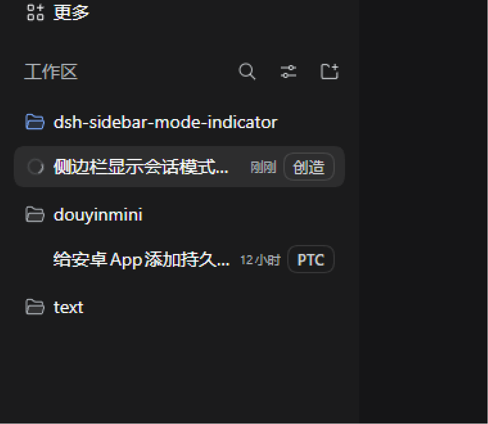
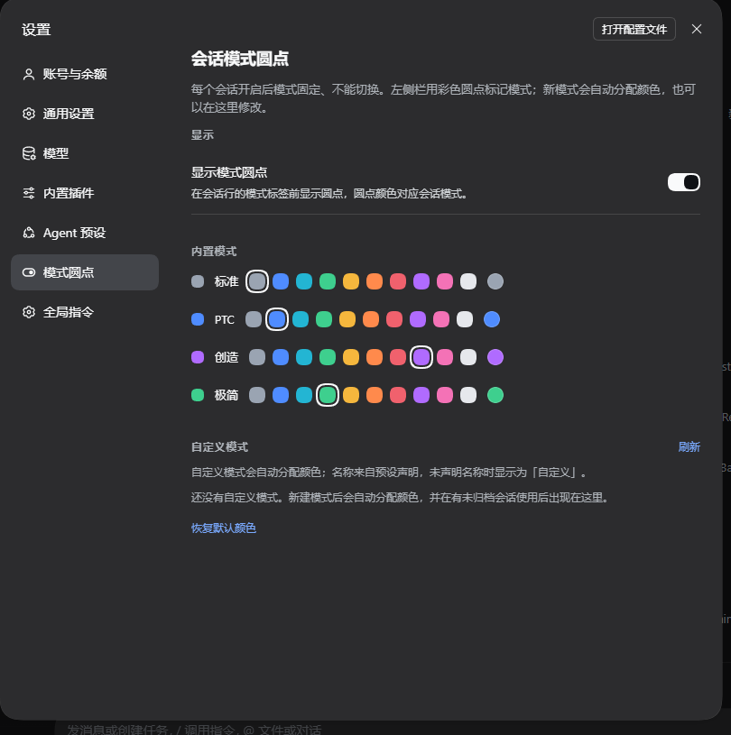

# dsh-session-mode-indicator

Left-sidebar indicator for the mode (agent preset) each Session runs under.

[简体中文](README.zh.md) | **English**



Each Session keeps the mode it started with, and that mode cannot change once
the Session opens. The plugin adds one piece of row metadata to the sidebar:
a small pill with a colored dot and the mode's name. The dot color identifies
the mode.



## Installation

Requirements: DeepSeek Harness `0.2.2-rc.1` (the desktop app, or a `dsh` profile such
as `web`). A plugin belongs to one profile — every session opened from that profile
loads it afterwards.

### With the `dsh` CLI

Install the harness CLI once. It needs Node.js 24.9+ and `pnpm` on `PATH`; the
desktop app also ships a `dsh` command that bundles both
(`resources\runtime\cli\bin` — add that folder to `PATH` instead, if you prefer):

```sh
npm install -g @deepseek-ai/dsh pnpm
```

Then install, update, or remove the plugin in a profile (`web` is only the profile
name — use whichever profile you launch):

```sh
dsh plugin --profile web add dsh-session-mode-indicator
dsh plugin --profile web update dsh-session-mode-indicator@latest
dsh plugin --profile web remove dsh-session-mode-indicator
```

`add` forwards to pnpm inside the profile and records the dependency and the bundle
layer in the profile `package.json`. There is no build step and no restart: the next
`dsh web` starts the UI with the plugin loaded.

Prefer a checkout? The same command installs a local copy instead of the registry
package — use an absolute path, and `link:` keeps loading the plugin from that
directory, so keep the folder:

```sh
git clone https://github.com/bailishta/dsh-sidebar-mode-indicator.git
dsh plugin --profile web add link:C:/path/to/dsh-sidebar-mode-indicator
```

### With the Plugin Manager (desktop app or Web session)

The `plugin_manager` tool ships with the Standard and Creator presets and installs
from a folder or a repository URL. Verified on DeepSeek Harness Desktop
`0.2.2-rc.1` (Windows).

1. Get the code and keep the folder in place — a linked bundle is loaded from
   that directory, so do not delete it afterwards:

   ```bash
   git clone https://github.com/bailishta/dsh-sidebar-mode-indicator.git
   ```

   (Downloading the ZIP and unzipping also works.)

2. In any DSH session, ask the agent to install the bundle. Do not edit the
   profile's `package.json` or `cordis.patch.yml` by hand — the Plugin Manager
   performs the package install, bundle selection and patch updates itself:

   > Use `plugin_manager` with `action: install_bundle` and target
   > `C:\path\to\dsh-sidebar-mode-indicator` (the absolute path of the folder).

   Installation requires the `danger-full-access` permission mode or an approval
   for that call. The agent may also install straight from the repository URL,
   since `install_bundle` accepts a GitHub/git spec.

3. The result must report `application: applied` and `enabled: true`. With HMR
   the plugin activates without a restart; a profile that runs without HMR needs
   a DSH restart before the sidebar and settings page appear.

4. Verify: the left sidebar shows a pill on each Session row, and
   **Settings → Mode dots** lists the built-in modes.

There is no build step: the package is plain ESM JavaScript, so no
`pnpm install` or compile is needed.

**Update** — `dsh plugin --profile web update dsh-session-mode-indicator@latest` for
a registry install. For a checkout: `git pull`, then remove and reinstall the bundle
(`dsh plugin --profile web remove`, then `add link:` again; or `plugin_manager`
`remove_bundle`, then `install_bundle` with the same path): replacing an installed
package needs a fresh client module generation, and a profile without HMR also needs
a restart.

**Uninstall** — `dsh plugin --profile web remove dsh-session-mode-indicator`,
`plugin_manager` `remove_bundle` with target `dsh-session-mode-indicator`, or turn
the bundle off on the sidebar Plugins page.

## Modes are discovered, not hard-coded

- The four shipped presets — standard, PTC, create (cordis), minimal — carry
  localized names and default colors.
- Every other preset is a custom mode. A custom mode is listed and colored
  only while it is still a declaration in the current profile or is used by a
  live Session that is neither archived nor blank; retired presets and
  archived-only or blank test modes stop being listed, and their pinned color
  is dropped so it no longer reserves a hue.
- When a custom mode is first seen it gets a color automatically: a
  deterministic FNV-1a hash of its id seeds a vivid palette, probing past
  colors already in use so two modes rarely share one. The result is pinned in
  browser storage, so a mode keeps its color across restarts.
- Custom modes show their published preset name when they have one; otherwise
  they render as the generic "Custom" label (the color still identifies them).

Nothing has to be edited in this package when a new mode appears.

## Settings

Settings → **Mode dots** (right after Agent presets) contains:

- **Show mode dots** — toggles the dot in the sidebar pill.
- **Built-in modes / Custom modes** — one row per known mode with a color
  preview, ten preset swatches, and a native color picker; custom rows also
  show the full preset id.
- **Refresh** — re-reads the preset roster, picking up presets installed since
  the page was opened.
- **Reset colors** — drops user colors and re-derives the automatic ones.

The preference lives in this Web client's `localStorage`
(`dsh.session-mode-indicator.settings.v1`, shape version 2; the pre-v2
`colors` shape is migrated on read).

## Interface for future modes

The plugin provides the Client service `sessionModeIndicator`. A plugin that
knows a mode's display name or wants to reserve its color registers it ahead
of time:

```js
export const inject = ['sessionModeIndicator']

export function apply(ctx) {
  ctx.effect(() =>
    ctx.sessionModeIndicator.registerMode({
      id: 'my-mode',            // required, matches the preset id
      name: 'My mode',          // optional display name
      color: '#4f8cff',         // optional reserved #rrggbb color
    }),
  )
}
```

`registerMode` returns a disposer; retire the contribution by calling it or by
registering inside `ctx.effect`. The service also exposes `getModes()` (the
current `{ id, name, color, builtin, contributed }` list) and `subscribe(fn)`
for consumers that follow changes. Contributions live only while their plugin
is loaded; auto-assigned colors keep working without any contributor.

## Publishing

A release is published from the repository root under the name in `package.json` —
there is no build step:

```sh
npm login
npm publish
```

`npm pack --dry-run` lists exactly which files ship.

## Files

- `client.js` — the whole UI: sidebar pill, settings section, color model,
  public service.
- `index.js` / `cordis.patch.yml` — the Host row and its bundle patch.
- `locale/*.json` — Plugin Manager title/description.
- `docs/mode-badge-preview.png` — sidebar preview.
- `docs/settings-preview.png` — settings page preview.
