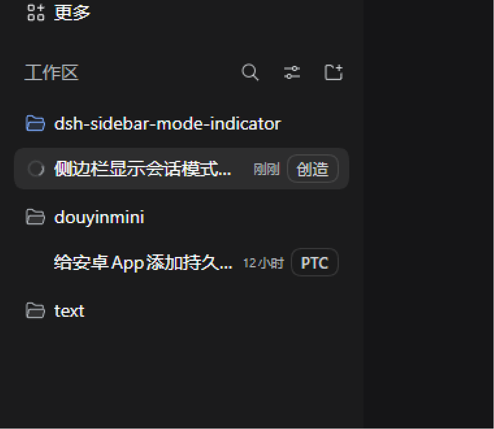
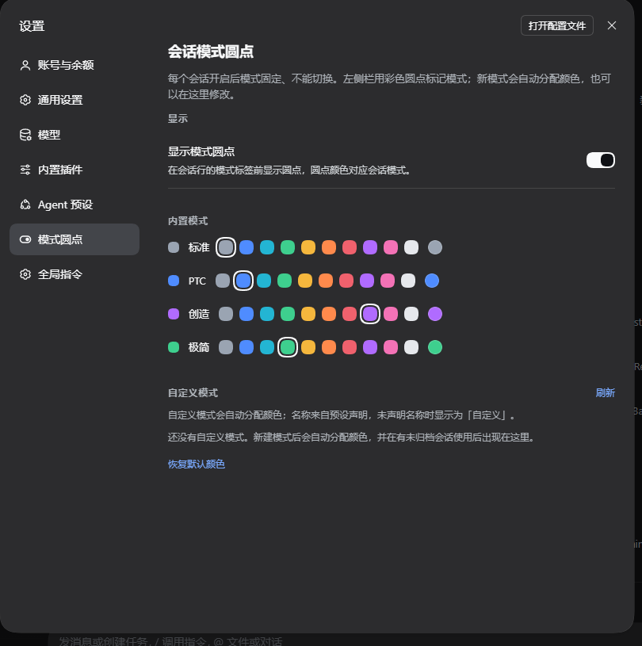

# dsh-session-mode-indicator

左侧栏显示每个会话运行在哪个模式（agent preset）下。

[English](README.md) | **简体中文**

[](https://www.npmjs.com/package/dsh-session-mode-indicator)



每个会话开启后模式固定、不能切换。插件给左侧栏的会话行加一条元数据：带彩色圆点和模式名的小胶囊，圆点颜色就是模式。



## 安装方法

需要 DeepSeek Harness `0.2.2-rc.1` 或更新版本。插件装进某个 profile，从该 profile
打开的会话都会加载它。

```sh
dsh plugin --profile web add dsh-session-mode-indicator              # 安装
dsh plugin --profile web update dsh-session-mode-indicator@latest    # 升级
dsh plugin --profile web remove dsh-session-mode-indicator           # 卸载
```

CLI 需要 Node.js 24.9+，并且 `PATH` 上有 `pnpm`；桌面版自带一份 `dsh` 命令（把它的
`resources\runtime\cli\bin` 目录加进 `PATH` 即可）。上面的 `web` 只是 profile 名，
换成你实际启动的那个，然后用 `dsh web` 打开界面。

桌面版也可以在 **Add plugin** 向导里搜索 `dsh-session-mode-indicator` 安装，或让
agent 用 `plugin_manager` 的 `install_bundle`。

没有构建步骤：插件是纯 ESM JavaScript。

验证：左侧栏每个会话行出现模式胶囊，设置里出现 **模式圆点** 页面。

## 模式不是写死的

- 4 个内置模式（标准、PTC、创造、极简）使用本地化名称和默认颜色。
- 其余预设一律视为自定义模式。只有当它仍是当前 profile 里的声明，或被**未归档且非空白**的会话使用时，才会计入列表和配色；已弃用的预设、已归档或空白会话里的测试模式不再显示，它们占用的自动配色也会被释放。
- 新模式第一次出现时自动上色：用模式 id 做 FNV-1a 哈希在鲜艳色板里取起点，向后探测已占用的颜色，尽量做到一色一模式；结果会固化保存在浏览器里，重启后颜色不变。
- 自定义模式优先显示预设声明的名称；没有名称时显示「自定义」（靠颜色区分）。

出现新模式不需要改这个插件的任何代码。

## 设置

设置 → **模式圆点**（在 Agent 预设下面）包含：

- **显示模式圆点**：控制侧栏胶囊里的圆点是否显示。
- **内置模式 / 自定义模式**：每个模式一行，带当前色预览、10 个预设色、系统取色器；自定义模式还会显示完整 id。
- **刷新**：重新读取当前 profile 的预设列表，新装的预设不用重启就能出现。
- **恢复默认颜色**：清除手动色并重新推导自动色。

偏好保存在当前 Web 客户端的 `localStorage`（`dsh.session-mode-indicator.settings.v1`，结构版本 2；旧的 v1 `colors` 结构会在读取时迁移）。

## 给后续模式留的接口

插件提供 Client 服务 `sessionModeIndicator`。知道某个模式显示名、或想给它预留颜色时，可以在使用前注册：

```js
export const inject = ['sessionModeIndicator']

export function apply(ctx) {
  ctx.effect(() =>
    ctx.sessionModeIndicator.registerMode({
      id: 'my-mode',        // 必填，与预设 id 一致
      name: 'My mode',      // 可选，显示名（不填则显示为「自定义」）
      color: '#4f8cff',     // 可选，预留 #rrggbb 颜色
    }),
  )
}
```

`registerMode` 返回 disposer（在 `ctx.effect` 里注册会自动随插件卸载释放）。服务还提供 `getModes()`（当前 `{ id, name, color, builtin, contributed }` 列表）和 `subscribe(fn)`。贡献只在提供方插件加载期间生效；没有贡献时自动配色照常工作。

## 文件

- `client.js` — 全部界面逻辑：侧栏胶囊、设置分区页、配色模型、对外服务。
- `index.js` / `cordis.patch.yml` — Host 插件行与 bundle 补丁。
- `locale/*.json` — 插件管理器里的标题与描述。
- `docs/mode-badge-preview.png` — 侧栏预览。
- `docs/settings-preview.png` — 设置页预览。
